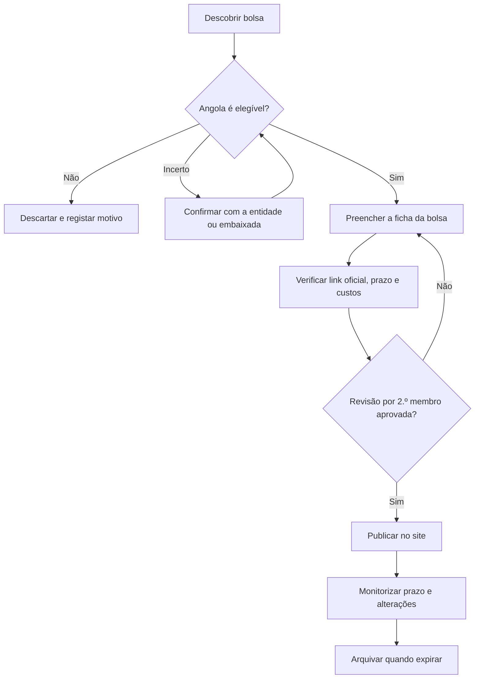

# 7. Método de Recolha e Verificação de Bolsas

## 7.1 Objetivo
Definir como a equipa vai **encontrar, verificar, registar e manter atualizadas** as bolsas publicadas no site, para que a informação seja fiável, completa e útil para candidatos angolanos.

O método escolhido é a **curadoria manual com fontes oficiais**: a equipa procura as bolsas, confirma a informação na fonte oficial e regista-a pelo painel de administrador (RF13, RF26 a RF28).

## 7.2 Princípios
1. **Só se publica o que se confirmou numa fonte oficial.** Agregadores e redes sociais servem para descobrir bolsas, nunca como fonte final.
2. **Elegibilidade primeiro.** Uma bolsa só entra no site se cidadãos angolanos puderem candidatar-se (RF08).
3. **Cada bolsa tem sempre o link oficial** e a data da última verificação (RNF09, RNF16).
4. **Escrever com palavras próprias.** Resumir os requisitos em linguagem simples e remeter para a fonte oficial; não copiar textos inteiros (direitos de autor).
5. **Duas pessoas por bolsa.** Quem recolhe não é quem revê.
6. **Na dúvida, não publicar.** Uma bolsa com elegibilidade ou custos duvidosos fica em rascunho até confirmação.

## 7.3 Onde procurar

| Categoria | Exemplos | Tipo | O que verificar |
|-----------|----------|------|-----------------|
| Entidades angolanas | INAGBE (Instituto Nacional de Gestão de Bolsas de Estudo), Ministério do Ensino Superior, universidades angolanas | Interna e externa | Calendário de concursos, critérios de seleção, vagas |
| Programas de governos estrangeiros | Chevening (Reino Unido), Fulbright (EUA), DAAD (Alemanha), Camões (Portugal), Governo da China, Turquia, entre outros | Externa | **Se Angola consta como país elegível** |
| Programas multilaterais | Erasmus+, CPLP, UNESCO, União Africana | Externa | Elegibilidade por região ou país |
| Universidades estrangeiras | Páginas de "financiamento para estudantes internacionais" | Externa | Cobertura, prazos, taxas, idioma |
| Embaixadas e institutos culturais em Luanda | Embaixadas e centros culturais dos países de destino | Externa | Programas anunciados localmente |
| Empresas e fundações | Programas de responsabilidade social, empresas do setor petrolífero e outras | Interna e externa | Critérios, áreas, renovação anual |
| Comunidade do site | Bolseiros e mentores | Interna e externa | Confirmar sempre na fonte oficial |
| Agregadores de bolsas | Sites que reúnem bolsas de vários países | Externa | **Só para descobrir**; ir sempre à fonte original |

> Os exemplos acima são pontos de partida. A equipa deve confirmar, em cada caso, se Angola é elegível antes de publicar. Alguns programas conhecidos são restritos a certos grupos de países.

## 7.4 Processo passo a passo

**Passo 1: Descobrir.** Percorrer as fontes da secção 7.3 segundo o calendário da secção 7.9.

**Passo 2: Triagem de elegibilidade.** Aplicar a checklist da secção 7.5. Se Angola não é elegível, descartar e anotar o motivo no registo para não repetir o trabalho.

**Passo 3: Preencher a ficha.** Usar o modelo da secção 7.6, completando todos os campos obrigatórios.

**Passo 4: Verificar.** Abrir o link oficial, conferir prazo, cobertura e custos, e anotar a data de verificação.

**Passo 5: Revisão cruzada.** Outro membro volta a abrir a fonte oficial e confirma os dados.

**Passo 6: Publicar.** O administrador regista a bolsa no painel (UC08), indicando tipo, cobertura e custos.

**Passo 7: Manter.** Rever o prazo e possíveis alterações; arquivar quando expirar (RF15).

## 7.5 Checklist de elegibilidade

Antes de aceitar uma bolsa, responder a todas as perguntas:

| # | Pergunta | Resposta aceite |
|---|----------|-----------------|
| 1 | O texto oficial permite candidaturas de cidadãos angolanos, ou Angola consta na lista de países elegíveis? | Sim, com a frase ou lista identificada |
| 2 | Há restrição de idade, género, área ou nível de estudo? | Registar como requisito |
| 3 | Exige residência, cidadania dupla ou nomeação por uma instituição? | Registar; se for obrigatório e inacessível, avaliar a relevância |
| 4 | A candidatura é gratuita ou tem taxa? | Registar; ver alertas anti-fraude (7.10) |
| 5 | O prazo ainda está em aberto? | Sim, com data |
| 6 | O link oficial funciona e pertence à entidade que oferece a bolsa? | Sim |

Se a resposta à pergunta 1 for "não sei", a bolsa fica em **rascunho** até haver confirmação com a entidade ou a embaixada.

## 7.6 Ficha da bolsa

Todas as bolsas usam a mesma ficha, que corresponde aos campos do painel de administrador.

| Campo | Descrição | Obrigatório | RF |
|-------|-----------|-------------|----|
| ID interno | Código da equipa (ex.: BOL-001) | Sim | n/a |
| Nome da bolsa | Nome oficial | Sim | RF07 |
| Entidade | Quem oferece a bolsa | Sim | RF07 |
| País de destino | País onde se estuda | Sim | RF06 |
| Tipo | Interna (Angola) ou externa (estrangeiro) | Sim | RF26 |
| Elegibilidade para angolanos | Sim, com a prova (frase ou lista de países) | Sim | RF08 |
| Cobertura | Integral (100% comparticipada) ou parcial | Sim | RF27 |
| Itens cobertos | Propinas, alojamento, alimentação, passagens, seguro de saúde, outros | Sim | RF27 |
| Custos a cargo do bolseiro | O que o bolseiro paga e valor estimado | Sim, se parcial | RF28 |
| Nível de estudo | Licenciatura, mestrado, doutoramento, curso técnico, etc. | Sim | RF06 |
| Área de estudo | Área ou "todas as áreas" | Sim | RF06 |
| Idioma exigido | Ex.: português, inglês, e nível pedido | Não | RF07 |
| Outros requisitos | Idade, média, experiência | Não | RF07 |
| Documentos exigidos | Lista dos documentos | Sim | RF07, RF16 |
| Data limite | Prazo de candidatura | Sim | RF07, RF12 |
| Link oficial | Página oficial de candidatura | Sim | RF09 |
| Fonte da descoberta | Onde a equipa encontrou a bolsa | Não | n/a |
| Data da última verificação | Quando se confirmou a informação | Sim | RNF16 |
| Verificado por | Membro da equipa que reviu | Sim | n/a |
| Estado | Ver secção 7.8 | Sim | n/a |
| Notas | Observações internas | Não | n/a |

### Exemplo de preenchimento (fictício, apenas para ilustrar)

| Campo | Valor |
|-------|-------|
| ID interno | BOL-000 |
| Nome da bolsa | Bolsa Exemplo de Mestrado |
| Entidade | Universidade Exemplo |
| País de destino | País Exemplo |
| Tipo | Externa |
| Elegibilidade para angolanos | Sim; o regulamento lista Angola entre os países elegíveis |
| Cobertura | Parcial |
| Itens cobertos | Propinas e alojamento |
| Custos a cargo do bolseiro | Passagens, seguro de saúde e alimentação (valor por confirmar) |
| Nível de estudo | Mestrado |
| Documentos exigidos | Certificado de habilitações, CV, carta de motivação, passaporte |
| Data limite | (data indicada no regulamento) |
| Link oficial | (endereço da página oficial) |
| Data da última verificação | (data em que a equipa conferiu) |
| Estado | Publicada |

## 7.7 Como classificar a cobertura

A equipa deve aplicar sempre a mesma regra, para que "100% comparticipada" tenha o mesmo significado em todas as bolsas:

- **Integral (100% comparticipada):** o bolseiro não paga nenhum dos custos principais, isto é, propinas, alojamento, alimentação ou subsistência, passagens e seguro de saúde. Se algum destes itens não estiver coberto, a bolsa é **parcial**.
- **Parcial:** cobre apenas alguns itens. A ficha deve listar o que está coberto e o que o bolseiro paga.
- **Informação insuficiente:** se o regulamento não deixa claro, não classificar como integral; registar "por confirmar" e não publicar o selo de 100% (RF29).

Decisão para a equipa: confirmar se esta definição de integral é a pretendida ou se algum item (por exemplo, passagens) deve ser tratado de outra forma.

## 7.8 Estados de uma bolsa

| Estado | Significado |
|--------|-------------|
| Rascunho | Em preenchimento ou à espera de confirmação (elegibilidade ou custos) |
| Em revisão | Preenchida; aguarda a verificação do segundo membro |
| Publicada | Visível no site |
| A expirar | Faltam poucos dias para o prazo (dispara alertas, RF12) |
| Arquivada | Prazo terminado (RF15) |
| Removida | Retirada por erro, fraude ou perda de elegibilidade |

## 7.9 Organização da equipa e rotina

### Papéis
| Papel | Responsabilidade |
|-------|------------------|
| Recolhedor | Procura bolsas nas fontes que lhe foram atribuídas e preenche as fichas |
| Revisor | Confirma os dados na fonte oficial antes da publicação |
| Responsável de atualização | Controla prazos, links e alterações das bolsas publicadas |

Cada membro pode ter mais de um papel, mas **nunca revê as fichas que ele próprio preencheu**.

### Rotina semanal sugerida
| Quando | Tarefa |
|--------|--------|
| Início da semana | Percorrer as fontes atribuídas e registar bolsas novas |
| A meio da semana | Preencher fichas e rever as de outro membro |
| Fim da semana | Publicar as aprovadas, verificar links das publicadas, arquivar as expiradas |

### Divisão das fontes
Dividir por tipo de fonte (por exemplo: entidades angolanas, programas de governos, universidades, embaixadas e fundações) para evitar trabalho duplicado.

### Meta inicial (sugestão a ajustar pela equipa)
Antes do lançamento, ter um conjunto mínimo de bolsas verificadas, com mistura de internas e externas e de integrais e parciais, para que os filtros façam sentido.

## 7.10 Alertas anti-fraude

Os candidatos confiam no site, por isso a equipa deve recusar bolsas com estes sinais:

- Pedem **pagamento** para "garantir" a bolsa ou para avaliar a candidatura, fora de taxas normais e claramente documentadas na fonte oficial.
- Prometem aprovação garantida.
- Comunicam só por email gratuito (como Gmail ou Hotmail) ou só por redes sociais, sem site oficial da entidade.
- Têm erros graves de escrita, prazos impossíveis ou pressão para decidir de imediato.
- O link oficial não pertence à entidade que alegadamente oferece a bolsa.
- Não é possível confirmar a existência da entidade.

Quando houver dúvida, confirmar diretamente com a entidade ou a embaixada correspondente.

## 7.11 Contributos da comunidade (Versão 2)

Bolseiros e mentores podem sugerir bolsas. O processo é:

1. A sugestão chega à equipa (formulário ou mensagem).
2. A equipa trata-a como uma descoberta nova: triagem, ficha, verificação e revisão.
3. Só se publica depois da confirmação na fonte oficial.

Assim a comunidade ajuda a descobrir bolsas, mas não substitui a verificação.

## 7.12 Ferramentas

| Ferramenta | Uso |
|------------|-----|
| Folha de cálculo partilhada | Registo de todas as bolsas e dos estados |
| Google Alerts | Alertas com termos como "bolsas de estudo Angola" |
| Newsletters | Subscrição das entidades e programas mais relevantes |
| Calendário partilhado | Prazos das bolsas e dias de revisão |
| Repositório GitHub | Documentação e, no futuro, importação de dados |

## 7.13 Riscos e mitigação

| Risco | Impacto | Mitigação |
|-------|---------|-----------|
| Informação desatualizada | Candidato perde prazo ou candidata-se sem cumprir requisitos | Data de verificação visível (RNF16); revisão semanal |
| Elegibilidade errada | Perda de confiança no site | Checklist (7.5) e revisão cruzada |
| Bolsa fraudulenta | Dano ao candidato | Alertas anti-fraude (7.10) |
| Link quebrado | Candidato não consegue candidatar-se | Verificação periódica; opção de reportar (UC05) |
| Cobertura mal classificada | Candidato surpreendido com custos | Regra única (7.7) |
| Violação de direitos de autor | Problema legal | Resumos com palavras próprias e remissão para a fonte |
| Sobrecarga da equipa | Atraso nas atualizações | Divisão de fontes e meta realista |

## 7.14 Porque não usar recolha automática (web scraping) nesta fase

- Muitos sites proíbem-no nos termos de utilização.
- Cada site tem uma estrutura diferente, o que dá muito trabalho de manutenção.
- A informação extraída costuma estar incompleta e exige verificação manual de qualquer forma.
- Um erro de elegibilidade ou de custos custa mais do que o tempo poupado.

Uma importação semiautomática, para apoiar a equipa e não para a substituir, fica registada como requisito futuro (RFut08 em `06-requisitos-futuros.md`).

## 7.15 Modelo de registo de verificação

| ID | Bolsa | Fonte oficial | Data | Verificado por | Resultado | Observações |
|----|-------|---------------|------|----------------|-----------|-------------|
| BOL-001 | | | | | Aprovada / Rejeitada / Por confirmar | |

## 7.16 Ligação com os requisitos

| Aspeto do método | Requisitos |
|------------------|------------|
| Só bolsas elegíveis para angolanos | RF08 |
| Tipo interna/externa | RF26 |
| Cobertura e custos | RF27, RF28, RF29 |
| Link oficial | RF09, RNF09 |
| Data da última verificação | RNF16 |
| Painel de administrador | RF13, UC08 |
| Arquivo automático | RF15 |
| Alertas de prazo | RF12 |
| Contributos da comunidade | RF34, RF36 |
