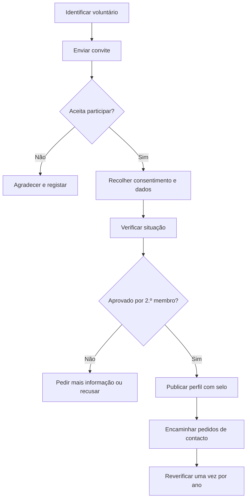

# 8. Recrutamento e Verificação de Bolseiros Voluntários

## 8.1 Objetivo
Definir como a equipa vai **encontrar, convidar, verificar e acompanhar** os bolseiros voluntários que partilham a sua experiência sobre a bolsa, o país e a universidade. A comunidade de bolseiros é o diferencial do projeto, e só tem valor se cada perfil for verdadeiro: a equipa garante que cada voluntário realmente faz parte de uma bolsa ou estuda fora antes de o publicar.

## 8.2 Quem pode ser bolseiro voluntário
| Situação | Descrição | Comprovativo principal | Confirmação complementar |
|----------|-----------|------------------------|--------------------------|
| Bolseiro atual | Tem uma bolsa de estudo neste momento | Carta de atribuição da bolsa | Cartão de estudante, declaração de matrícula ou email institucional |
| Antigo bolseiro | Já teve uma bolsa de estudo | Carta de atribuição da bolsa | Certificado, diploma ou declaração de conclusão |
| Estudante no estrangeiro | Estuda fora de Angola, com ou sem bolsa | Cartão de estudante ou declaração de matrícula atual | Email institucional ativo ou acesso à área de estudante mostrado em videochamada |

## 8.3 Princípios
1. **Só se publica quem foi verificado.** Sem verificação concluída, o perfil fica em rascunho.
2. **Voluntariado e consentimento.** Ninguém é publicado sem aceitar participar e sem consentir a publicação dos dados do perfil.
3. **Privacidade.** Os contactos pessoais não são públicos e o contacto é encaminhado pelo administrador (RNF14).
4. **Dados mínimos.** A equipa vê os comprovativos para confirmar, mas não os guarda (RNF22).
5. **Duas pessoas por perfil.** Quem verifica não é quem aprova.
6. **Gratuito.** Os bolseiros não cobram nem recebem pagamentos dos candidatos.

## 8.4 Onde encontrar voluntários
| Canal | Como abordar | Nota |
|-------|--------------|------|
| Contactos da equipa | Cada membro convida colegas, amigos e família que têm bolsa ou estudam fora | O canal mais rápido; começar por aqui |
| Professores e antigos colegas | Pedir que indiquem ex-alunos bolseiros | Pedir indicação, não listas de contactos |
| Grupos de angolanos no estrangeiro | Publicar o convite em grupos de redes sociais e no LinkedIn | Respeitar as regras de cada grupo |
| Associações e antigos alunos | Pedir às associações de estudantes e de antigos alunos que divulguem o convite | Não pedir listas de membros |
| Universidades e gabinetes de relações internacionais | Pedir que divulguem o convite entre estudantes angolanos | Apresentar o projeto por escrito |
| Os próprios voluntários | Pedir a quem aceita que indique colegas da mesma bolsa ou universidade | Cada pessoa indicada passa pelo mesmo processo |

## 8.5 Processo passo a passo

**Passo 1: Identificar e convidar.** Usar os canais da secção 8.4 e a mensagem-modelo da secção 8.14.

**Passo 2: Consentimento e dados.** O voluntário confirma por escrito que aceita participar e autoriza a publicação dos dados do perfil. A equipa recolhe a ficha da secção 8.8.

**Passo 3: Verificar.** Aplicar o método da secção 8.6.

**Passo 4: Revisão cruzada.** Um segundo membro da equipa confere o registo de verificação e aprova.

**Passo 5: Publicar.** O administrador cadastra o perfil, marca-o como verificado e o selo passa a aparecer (RF47, RNF15).

**Passo 6: Acompanhar.** O administrador encaminha os pedidos de contacto e acompanha se o voluntário continua disponível.

**Passo 7: Reverificar.** Uma vez por ano, ou quando a situação mudar (por exemplo, quando acaba a bolsa e passa a antigo bolseiro).

## 8.6 Como verificar
1. **Pedir o comprovativo.** O voluntário mostra-o em videochamada ou envia-o de forma privada, conforme a tabela da secção 8.2.
2. **Confirmar os dados.** O nome coincide com o do perfil, a instituição e o país estão corretos e o período ou a validade estão em vigor.
3. **Confirmar o email institucional.** Quando existir, enviar uma mensagem para esse email e receber resposta, ou ver a área de estudante em videochamada. Confirmar que o domínio pertence mesmo à instituição.
4. **Videochamada curta (5 a 10 minutos).** Confirma que a pessoa é quem diz ser e que sabe falar da experiência (curso, cidade, rotina, como funciona a bolsa).
5. **Aprovação por um segundo membro** da equipa.
6. **Registo e limpeza.** Guardar apenas a data, o método usado, quem verificou e o resultado. Apagar qualquer cópia de comprovativo recebida.

Se a videochamada não for possível, exigir dois comprovativos diferentes (por exemplo, carta de atribuição e email institucional).

## 8.7 Sinais de alerta
- Recusa mostrar qualquer comprovativo.
- Comprovativo com nome, datas ou instituição que não batem certo.
- Só tem email gratuito (como Gmail ou Hotmail) e nenhuma presença verificável na instituição.
- Pede dinheiro ou vantagens aos candidatos, ou promete garantir a bolsa.
- Pressa excessiva para ser publicado.
- Descrição da experiência vaga ou incoerente na videochamada.

Em caso de dúvida, não publicar e pedir mais informação.

## 8.8 Ficha do bolseiro
| Campo | Descrição | Público |
|-------|-----------|---------|
| Nome | Nome (ou nome e apelido) como será mostrado | Sim |
| Situação | Bolseiro atual, antigo bolseiro ou estudante no estrangeiro | Sim |
| Bolsa | Nome da bolsa e entidade, se aplicável | Sim |
| País | País onde estuda ou estudou | Sim |
| Universidade | Instituição de ensino | Sim |
| Curso e ano | Curso e ano atual ou de conclusão | Sim |
| Apresentação | Texto curto sobre si | Sim |
| Relato | Como funciona a bolsa, o país e a universidade | Sim |
| Email de contacto privado | Usado só pela equipa | Não |
| Consentimento | Data e forma em que foi dado | Não |
| Verificado em / por | Data e membro da equipa | Não |
| Estado | Ver secção 8.9 | Não |

## 8.9 Estados do bolseiro
| Estado | Significado |
|--------|-------------|
| Contactado | Foi convidado |
| Interessado | Aceitou participar; falta consentimento e verificação |
| Em verificação | A equipa está a verificar a situação |
| Verificado | Perfil publicado com selo |
| Suspenso | Retirado temporariamente (dúvida, queixa ou reverificação em falta) |
| Removido | Retirado definitivamente, a pedido do voluntário ou por incumprimento |

## 8.10 Código de conduta do voluntário
- Partilhar a sua experiência real e dizer que é a sua experiência pessoal, não uma garantia.
- Não cobrar nem aceitar pagamentos dos candidatos.
- Não prometer aprovação nem "garantir" bolsas.
- Não pedir documentos nem dados pessoais sensíveis aos candidatos.
- Responder dentro de um prazo razoável ou avisar quando não puder.
- Respeitar a privacidade e tratar todos com respeito.
- Avisar a equipa quando a sua situação mudar.

O incumprimento leva à suspensão ou remoção do perfil.

## 8.11 Dados pessoais e consentimento
- Recolher só o necessário (ficha da secção 8.8).
- Publicar apenas os campos marcados como públicos, e só com consentimento (RNF21).
- O voluntário pode pedir a remoção do perfil a qualquer momento.
- Não guardar cópias dos comprovativos (RNF22).
- Seguir a lei angolana de proteção de dados pessoais; confirmar a referência exata com o professor.

## 8.12 Motivação e reconhecimento
Os voluntários não são pagos. A equipa pode oferecer:
- O selo "Bolseiro verificado" e visibilidade no site.
- Uma declaração de participação como voluntário, emitida pela equipa.
- Uma recomendação pública, por exemplo no LinkedIn, se o voluntário o desejar.
- A satisfação de ajudar outros angolanos a conseguirem uma bolsa.

## 8.13 Contacto entre candidato e bolseiro
**No MVP:** o candidato escreve a pergunta (RF48), o pedido fica guardado e o administrador encaminha-o ao bolseiro, sem revelar contactos pessoais (RF49). O bolseiro responde ao administrador ou, se ambos concordarem, o administrador põe-os em contacto direto.

**Na versão 2:** os bolseiros passam a ter conta própria e respondem diretamente pela plataforma, com moderação e denúncia (RF30 a RF39).

## 8.14 Modelos

### Mensagem de convite
Olá [nome]! Sou o [nome], da equipa do [Nome do Site], uma plataforma que reúne bolsas de estudo para angolanos. Estamos a criar uma comunidade de bolseiros voluntários que contam como funciona a bolsa, o país e a universidade a quem se quer candidatar. Tem ou teve uma bolsa, ou estuda fora de Angola? Gostaria de participar? Não tem custos nem horário fixo e pode sair quando quiser. Se sim, envio-lhe os detalhes. Obrigado!

### Consentimento
Eu, [nome], aceito participar como bolseiro voluntário no [Nome do Site]. Autorizo a publicação dos seguintes dados no meu perfil: nome, situação, bolsa, país, universidade, curso, ano, apresentação e relato. Sei que o meu contacto pessoal não será público e que os pedidos dos candidatos me serão enviados pela equipa. Não cobro nem aceito pagamentos dos candidatos e não prometo aprovação em bolsas. Posso pedir a remoção do meu perfil a qualquer momento. Resposta por escrito (mensagem ou email), com data.

### Registo de verificação
| Bolseiro | Situação | Método usado | Data | Verificado por | Aprovado por | Resultado |
|----------|----------|--------------|------|----------------|--------------|-----------|
| | | | | | | Aprovado / Recusado / Por confirmar |

## 8.15 Riscos e mitigação
| Risco | Impacto | Mitigação |
|-------|---------|-----------|
| Perfil falso | Perda de confiança no site | Verificação em duas etapas e revisão por um segundo membro |
| Pessoa que cobra aos candidatos | Dano ao candidato | Código de conduta, selo só para verificados e possibilidade de denúncia |
| Fuga de dados pessoais | Problema legal e de confiança | Dados mínimos, sem guardar comprovativos e contactos privados |
| Voluntários que deixam de responder | Candidatos sem resposta | Acompanhamento, sugestão de outro bolseiro e suspensão |
| Poucos voluntários | Comunidade vazia | Começar pelos contactos da equipa e pedir indicações aos voluntários |
| Informação desatualizada | Relato já não corresponde à realidade | Reverificação anual e data do relato visível |
| Sobrecarga do administrador | Pedidos por encaminhar | Limitar o número de bolseiros no início e passar à versão 2 quando crescer |

## 8.16 Meta inicial
- Pelo menos 5 bolseiros verificados antes da demonstração.
- De preferência de 2 ou mais países e com pelo menos 1 bolsa interna.
- Crescer depois com as indicações dos próprios voluntários.

## 8.17 Ligação com os requisitos
| Aspeto | Requisitos |
|--------|------------|
| Administrador cadastra e verifica bolseiros | RF47, UC30 |
| Comunidade de bolseiros e bolseiros por bolsa | RF34, RF35, UC17 |
| Pedido de contacto e encaminhamento | RF48, RF49, UC29, UC31 |
| Pedido de verificação e perfil próprio (V2) | RF30, RF31, RF32 |
| Contactos intermediados | RNF14 |
| Selo de verificação | RNF15 |
| Consentimento | RNF21 |
| Comprovativos não guardados | RNF22 |
